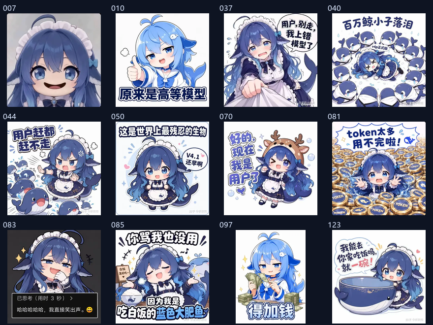

# ricefish · 白饭鱼

> 一条住在你 QQ 里的 AI 胖鱼。靠 DeepSeek 说话，靠白饭吃活。
> 记得住人，会接梗，会撒娇，也会被一句「大肥鱼」气到炸毛。

[](https://github.com/Quin557/ricefish/actions/workflows/ci.yml)
[](LICENSE)
[](https://www.python.org/downloads/)

**完全没写过代码？** 不用怕，也不用打开命令行。照着下面的「零基础安装」做，
双击一个 `start.bat`，剩下交给弹窗。

> **先说明白：发行包不是装好就能直接聊天的绿色版。**
> 它是「项目文件 + 一键启动脚本」。第一次运行仍然要双击 `start.bat`，
> 由脚本检查 Python、下载 NapCat、让你填配置、用手机 QQ 扫码登录。
> 之后每次也只要双击 `start.bat`。

<p align="center">
  
  
</p>
<p align="center">
  
</p>

**文档**：[安装与使用（本页）](#零基础安装windows约-20-分钟) ·
[架构](docs/ARCHITECTURE.md) · [部署/24h](docs/DEPLOY.md) · [面板](docs/PANEL.md) ·
[识图评测](docs/VISION_EVAL.md) · [素材许可](docs/LICENSES.md) · [更新日志](CHANGELOG.md) ·
[参与贡献](CONTRIBUTING.md) · [安全](SECURITY.md)

---

## 目录

- [这是什么](#这是什么)
- [开始之前：准备 3 样东西](#开始之前准备-3-样东西)
- [零基础安装（Windows，约 20 分钟）](#零基础安装windows约-20-分钟)
- [第一次使用：加白名单、关试运行](#第一次使用加白名单关试运行)
- [日常使用](#日常使用)
- [出问题怎么办](#出问题怎么办)
- [更新、备份、卸载](#更新备份卸载)
- [仓库里有什么、没有什么](#仓库里有什么没有什么)
- [进阶：功能与配置](#进阶功能与配置)
- [素材来源与许可](#素材来源与许可)
- [边界与态度](#边界与态度)

---

## 这是什么

ricefish 是一个**跑在你自己电脑上的 QQ 聊天机器人**：

- 用 [NapCat](https://github.com/NapNeko/NapCatQQ) 把 QQ 消息转成 OneBot 11；
- 用 DeepSeek 生成回复；
- 人设、记忆、表情、语音、聊天记录全部存在你本机。

它不是一个网页服务，也不需要买服务器。你的电脑开着、QQ 小号在线，它就能在群里/私聊里说话。

它能做的事（详细说明见[进阶](#进阶功能与配置)）：

- 群聊里 @ 它、回复它、叫它名字才会接话；私聊默认每条都回。
- 三层记忆：最近聊天、滚动摘要、长期事实；记得住每个人的喜好和雷点。
- 引用回复、分条发送、打字延迟、流式输出，尽量像真人打字。
- 发表情包、梗图、预录语音；别人发图它能看懂大概。
- 猜词、21 点、海龟汤；群友戳一戳会回应。
- 本地 Web 管理面板：白名单、成员档案、人设、记忆、日志、频率设置。
- 插件：往 `plugins/` 扔一个 `.py` 就能加功能。

### 它不是

- 不是 DeepSeek 官方产品，也不是 QQ 官方机器人；
- 不是客服，不保证回答正确；
- 不会替你自动加好友、群发广告；
- 不能保证 QQ 小号不被风控。第三方协议登录有风险，请一定看下面的提醒。

---

## 开始之前：准备 3 样东西

| 需要 | 说明 | 没有会怎样 |
|---|---|---|
| **Windows 10/11 电脑** | 64 位，能正常上网 | 目前一键脚本只做 Windows |
| **一个 QQ 小号** | 专门给机器人用，**不要用你的主号** | 用主号有被限登/冻结的风险 |
| **DeepSeek API Key** | `sk-` 开头，按用量付费 | 机器人不会说话 |

另外准备：

- 约 **2 GB 空闲磁盘**（NapCat + QQ 比较大）；
- 第一次安装时需要联网下载 NapCat；
- 手机上的 QQ（用来扫码登录小号）。

### 怎么申请 DeepSeek API Key

1. 打开 <https://platform.deepseek.com/>，注册/登录。
2. 在「充值」里充一点钱（几块钱也能先用很久，具体价格以官网为准）。
3. 打开「API Keys」→「创建 API Key」。
4. 复制弹出的 `sk-...`。**这个 Key 通常只显示一次**，丢了就重新建一个。
5. 先把它粘贴到记事本里备用。

> 费用参考：一个中等活跃的群，每天大约几块钱以内；具体看调用量。
> 面板「概览」能看到实际 token 用量。

### ⚠️ 关于 QQ 风控

NapCat 走的是 QQ 客户端协议，不是官方机器人接口。所有这类方案都有**小号被限登、冻结几天**的概率。
所以请：

- 一定用小号；
- 先在只有你和另一个号的测试群里跑；
- 默认的「试运行」先开一天，确认没问题再关；
- 不要一上来就加很多群、频繁主动发言。

---

## 零基础安装（Windows，约 20 分钟）

下面每一步都写清楚「你会看到什么」和「你要做什么」。跟着做就行。

### 第 1 步：下载发行包

打开项目的 Release 页面：

**<https://github.com/Quin557/ricefish/releases/latest>**

在「Assets」里下载：

```text
ricefish-v0.3.1.zip
```

不要点绿色的 `Code` 按钮下载源码（也能用，但不会带 `使用说明.txt`，而且容易下错分支）。
如果页面打不开，见[出问题怎么办](#出问题怎么办)。

### 第 2 步：解压到一个简单路径

1. 右键 zip →「全部解压缩」。
2. 解压到 **`D:\ricefish`** 这类路径。
3. 路径里**不要有中文、空格、特殊符号**（NapCat 对中文路径比较敏感）。

解压后文件夹里应该直接能看到：

```text
start.bat
setup.ps1
run.py
README.md
使用说明.txt
config\
src\
assets\
```

如果看到的是 `ricefish-v0.3.1\ricefish-v0.3.1\start.bat` 这种套了两层，
把里面那层文件夹整个移到 `D:\ricefish`，保证 `start.bat` 就在 `D:\ricefish` 下。

### 第 3 步：双击 start.bat

双击 **`start.bat`**。会弹出一个黑色的命令行窗口，这是正常的。

可能遇到的提示：

- **「Windows 已保护你的电脑」**：点「更多信息」→「仍要运行」。
- **杀毒软件拦截**：把整个 `D:\ricefish` 加入信任区（火绒、360 等都可能拦 QQ）。
- **提示没有 Python**：脚本会问你要不要自动安装，点「是」；
  如果自动安装失败，去 <https://www.python.org/downloads/> 下载安装，
  安装时**务必勾选「Add python.exe to PATH」**，装完重新双击 `start.bat`。
- **窗口一闪就没了**：先看同目录下的 `setup.log`；或者右键「在终端中打开」，
  运行 `start.bat -CheckOnly`，它会停在窗口里显示检查结果。

### 第 4 步：按弹窗填 4 项配置

脚本会依次弹窗，标题里带「ricefish 第 1 步 / 3」这类字样。四项都可以先留空，
之后在 `.env` 或面板里改，但建议第一次就填好：

| 弹窗 | 填什么 | 不填会怎样 |
|---|---|---|
| 第 1 步：DeepSeek API Key | 刚才复制的 `sk-...` | 机器人不会说话 |
| 第 2 步：主人 QQ | **你自己的 QQ 号**（不是小号） | 管理命令没人能用 |
| 第 3 步：允许说话的群 | 群号，多个用逗号隔开 | 群里它不吭声 |
| 私聊白名单 | 允许私聊它的人，一般填你自己 | 私聊不回 |

> 不知道群号？可以留空先继续。等 NapCat 登录后，在面板「白名单」页
> 点「从已知群聊里选择」会更方便。

脚本还会自动生成两个密码（连接 token、面板 token），不用你记，后面会自动用。

### 第 5 步：等它下载 NapCat

配置填完后，脚本会：

1. 检查/下载 NapCat 到 `vendor\napcat\`；
2. 打开 NapCat 安装器（如果弹出来，按提示点下一步）；
3. 自动写好反向 WebSocket 配置；
4. 启动 NapCat。

第一次下载可能比较慢。**下载失败**时，脚本会弹出提示并打开下载页，按弹窗里的手动步骤做：

1. 打开 <https://github.com/NapNeko/NapCatQQ/releases/latest>
2. 下载 `NapCat.Shell.Windows.OneKey.zip`
3. 解压到 `D:\ricefish\vendor\napcat\`
4. 运行里面的 `NapCatInstaller.exe`
5. 再双击 `start.bat`

### 第 6 步：用手机 QQ 小号扫码

NapCat 启动后，脚本会打开登录页（或提示你看 NapCat 窗口里的二维码）：

1. 用**手机 QQ 的小号**扫二维码（**千万别用主号**）；
2. 手机上点「确认登录」；
3. 电脑上的 QQ 显示在线后，回到弹窗点「确定」。

如果二维码过期，登录页里可以刷新。如果登录页没自动打开，浏览器手动打开：

```text
http://127.0.0.1:6099/webui
```

这里的密码/token 在 NapCat 窗口日志里。

### 第 7 步：打开管理面板，加白名单

机器人启动后，脚本会自动打开管理面板：

```text
http://127.0.0.1:8721
```

如果没自动打开，手动在浏览器输入上面的地址。面板 token 在启动弹窗里，
也可以打开项目里的 `.env`，找 `RICEFISH_PANEL_TOKEN=` 这一行。

进去后做两件事：

1. 左侧「白名单」→ 在「群聊」里点「从已知群聊里选择」，找到你的群，点「加入」；
2. 同样把允许私聊的人加进「好友」白名单。

> **白名单为空 = 机器人谁都不理。** 这是故意的安全阀。
> 面板里改完立即生效，不需要重启。

### 第 8 步：先试运行，再正式说话

默认是**试运行（dry_run）**：机器人会正常思考，但只把「本来会发什么」写进日志，
不会真的发到群里。这是给你确认它说话是否合适的。

1. 在群里 @ 小号，或者私聊它，发一句「在吗」。
2. 看命令行窗口 / 面板「日志」：能看到它的回复内容，但群里没有消息，说明试运行正常。
3. 确认没问题后，打开面板「设置」→ 找到「试运行（只打日志不发送）」→
   改成「真实发送」→ 点「保存」。
4. 再 @ 它一次，这次应该真的回消息了。

到这里就装好了。以后每次只要双击 `start.bat`。

---

## 第一次使用：加白名单、关试运行

如果你已经按上面做完，可以跳过这一节。这里再强调几个最容易踩的坑：

- **群里普通聊天它不会回**，这是设计：只有 @ 它、回复它、或者叫它名字（默认「肥鱼」）才会触发。
- **白名单是空的就完全不回**，先去面板「白名单」加群/好友。
- **`dry_run` 没关就只在日志里说话**，去面板「设置」关掉。
- **私聊也要加白名单**，否则私聊不回。
- **第一次建议**：先在一个只有你和另一个号的测试群里跑两天，再放进真群。

### 想改它的性格

打开 `config/personas/global.md`，这是它的全局人设，纯文本，改完下一条消息就生效。
群人设放在 `config/personas/groups/<群号>.md`，私聊人设放在
`config/personas/private/<QQ>.md`，都只对对应会话生效。

> 这些「真实群号/QQ 命名」的人设文件已经在 `.gitignore` 里，
> 只存在你本地，不会上传到 GitHub。

---

## 日常使用

### 启动 / 停止

- 启动：双击 `start.bat`。已装好的步骤会自动跳过，直接启动。
- 停止：关掉写着 ricefish 和 NapCat 的两个黑色窗口；或者在窗口里按 `Ctrl+C`。
- 下次启动还是双击 `start.bat`，不需要重新扫码（QQ 登录状态一般会保留）。

### 面板能做什么

| 页面 | 用途 |
|---|---|
| 概览 | 协议端是否在线、消息/token 用量、白名单入口 |
| 会话 | 白名单里的群和私聊，进入详情看成员/记忆 |
| 白名单 | 加群、加好友；改完立即生效 |
| 成员 | 备注、亲密度、人工确认（防止记忆被自动改歪） |
| 记忆 | 它记住的长期事实，可搜索/删除 |
| 人设 | 全局 / 群 / 私聊三层人设 |
| 设置 | 试运行、主动插话、限流、并发、静默时段 |
| 日志 | 最近的运行日志 |

完整说明见 [docs/PANEL.md](docs/PANEL.md)。

### 常用指令

在群里 @ 它或私聊发送：

| 指令 | 说明 |
|---|---|
| `/帮助` | 全部指令 |
| `/我` | 你在它眼里的档案 |
| `/记忆 关键词` | 查它记住了什么 |
| `/忘掉 关键词` | 让它忘掉 |
| `/总结 [条数]` | 总结最近聊天 |
| `/梗` | 这个群的梗词典 |
| `/梗图` | 随机发一张梗图 |
| `/天气 [城市]` | 查天气（免 Key） |
| `/猜词` `/21点` `/汤` | 小游戏 |
| `/语音` `/语音 摸头` | 播放内置语音 |
| `/语音 文本` | 用 edge-tts 现场合成一句 |
| `/叫我 阿澈` | 给自己设个称呼 |
| `/设定 <内容>` | 让它记住一条设定 |
| `/学习 <链接或资料>` | 看一遍并记进长期记忆 |
| `/收表情 无语` | 把这张图收进表情库 |
| `/开关` `/静音` `/重置` | 管理（仅管理员） |

---

## 出问题怎么办

先看项目目录下的 `setup.log`，再看 `data\logs\bot.log`。大部分错误都会写在这里。

### 双击 start.bat 没反应 / 窗口一闪而过

在项目文件夹空白处右键 →「在终端中打开」，运行：

```bat
start.bat -CheckOnly
```

它只检查环境，不下载、不启动，会把问题停在窗口里。

### 提示没有 Python / Python 版本太低

需要 Python 3.10 或更高。

1. 去 <https://www.python.org/downloads/> 下载最新版；
2. 安装时勾选 **Add python.exe to PATH**；
3. 关掉所有命令行窗口，重新双击 `start.bat`。

### NapCat 下载不动 / GitHub 打不开

按第 5 步里的手动方法：下载 `NapCat.Shell.Windows.OneKey.zip`，
解压到 `vendor\napcat\`，运行 `NapCatInstaller.exe`，再双击 `start.bat`。

### NapCat 登录页 / 二维码不显示

浏览器手动打开：

```text
http://127.0.0.1:6099/webui
```

token 在 NapCat 窗口日志里。二维码过期就刷新页面。

### 面板打不开

- 确认机器人窗口还开着；
- 端口 8721 可能被别的程序占用：打开 `.env`，把 `RICEFISH_PANEL_PORT=8721`
  改成别的（比如 `8722`），重启；
- 面板默认只监听 `127.0.0.1`，手机访问需要改 `web.host`，见 [docs/PANEL.md](docs/PANEL.md)。

### 机器人不回话

按顺序检查：

1. 面板「概览」里协议端是不是「已连接」；
2. 白名单是不是空的；
3. 是不是还开着「试运行」；
4. 群里普通聊天是故意不回的——要 @ 它、回复它、或者叫名字；
5. 看 `data\logs\bot.log` 里有没有 API 报错。

### API 报错 / 401 / 余额不足

- 检查 `.env` 里的 `DEEPSEEK_API_KEY` 是否复制完整；
- 去 DeepSeek 平台看余额；
- 改完 `.env` 要重启机器人。

### 账号被限登 / 被冻结

立刻停掉机器人，等解封。之后：

- 换小号或降低频率；
- 不要自动加好友、不要群发；
- 把 `trigger.proactive.probability` 调低，或者面板里关掉主动插话。

### 中文路径 / 火绒误杀

- 把项目移到 `D:\ricefish` 这种纯英文路径；
- 火绒提示「文件已损坏」时，把整个项目目录加入信任区。

### 语音没有声音

实时语音依赖 `edge-tts`。安装失败不影响聊天，只是没有实时语音。
重新运行 `start.bat` 会自动再试；也可以手动：

```bat
python -m pip install edge-tts
```

内置的 19 句离线语音包不需要联网，仍然可用。

---

## 更新、备份、卸载

### 备份

你的全部数据都在两个地方：

```text
data\       聊天数据库、日志、表情、语音包
.env        API Key、QQ、白名单种子、面板 token
```

想备份就关掉机器人，把 `data` 文件夹和 `.env` 复制到安全的地方。
面板「概览」里也能看到数据库路径。

### 更新到新版本

1. 关掉机器人；
2. 把整个 `D:\ricefish` 复制一份作为备份；
3. 下载新版本的 `ricefish-vX.Y.Z.zip`，解压到一个新文件夹；
4. 把旧文件夹里的 `data` 文件夹和 `.env` 复制到新文件夹；
5. 如果你改过 `config`，也把 `config` 复制过去（至少保留人设文件）；
6. 双击新文件夹里的 `start.bat`。

### 卸载

1. 关掉机器人；
2. 删除整个 `D:\ricefish` 文件夹；
3. 到 DeepSeek 平台把不用的 API Key 删掉；
4. 如果不想让小号保持登录，在手机 QQ 的「登录设备管理」里移除电脑。

删除前记得备份 `data`，否则聊天记忆会一起没掉。

---

## 仓库里有什么、没有什么

这个仓库是公开的，但**个人使用数据不会上传**：

| 内容 | 在仓库里吗 | 说明 |
|---|---|---|
| 代码、素材、文档、安装脚本 | ✅ | 公开 |
| `config/bot.yaml` 通用配置 | ✅ | 主人 QQ 等个人值已清空 |
| `config/personas/global.md` 公开人设 | ✅ | 不含个人 QQ/名字 |
| `config/personas/groups/example.md` | ✅ | 群人设模板 |
| `.env` | ❌ | API Key、QQ、白名单、token |
| `data/` | ❌ | 聊天记录、记忆、日志、表情、语音包 |
| `vendor/` | ❌ | NapCat/QQ，约 1.5 GB |
| `qr-now.png` | ❌ | 登录二维码，可能含账号信息 |
| `setup.log` | ❌ | 安装日志，可能含本机路径 |
| `config/personas/learned.md` | ❌ | 聊天里自动学到的设定 |
| `config/personas/groups/<群号>.md` | ❌ | 真实群专属人设 |
| `config/personas/private/<QQ>.md` | ❌ | 私聊专属人设 |

如果你 fork 或提交代码，请保留这些忽略规则，不要把 `.env` 或 `data/` 加进 Git。
更多安全说明见 [SECURITY.md](SECURITY.md)。

---

## 进阶：功能与配置

> 下面是给想继续折腾的人看的。只想正常聊天的话，可以到此为止。

### 项目结构

```text
ricefish/
├─ run.py                     启动入口
├─ start.bat                  一键启动（双击它）
├─ setup.ps1                  安装/配置/启动的实际逻辑
├─ 使用说明.txt               给不看 README 的人
├─ vendor/                    自动下载的 NapCat（gitignore）
├─ assets/                    图标、表情、梗图、语音（各自许可）
├─ config/
│  ├─ bot.yaml                主配置（个人值已清空）
│  ├─ emoji.yaml              表情名 -> 图片
│  └─ personas/
│     ├─ global.md            公开全局人设
│     ├─ groups/example.md    群人设模板
│     ├─ learned.md           自动生成（gitignore）
│     ├─ groups/<群号>.md     本地群专属（gitignore）
│     └─ private/<QQ>.md      本地私聊专属（gitignore）
├─ plugins/                   插件（扔 .py 进来就生效）
├─ docs/                      架构、部署、面板、识图评测
├─ src/ricefish/              主程序
│  ├─ onebot/                 OneBot 11 WS 服务端/事件/动作
│  ├─ core/                   触发、并发、限流、发送
│  ├─ companion/              会话视图、关系/情节/开放话题
│  ├─ llm/                    DeepSeek 客户端、提示词、抽取器
│  ├─ vision/                 图片理解
│  ├─ memory/                 SQLite、检索、迁移
│  ├─ features/               命令、游戏、表情、语音、工具、周报
│  ├─ web/                    管理面板（含 PWA）
│  └─ util/                   文本、日志
├─ scripts/                   初始化、回放、备份、发行构建
└─ tests/                     离线测试
```

### 功能细节

**聊天**

- 群聊：@ / 回复 / 叫名字必回；普通聊天按相关性概率插话。
- 私聊：默认每条都回。
- 流式输出：边生成边发；慢首 token 时先给表情回应或短确认。
- 引用、分条、打字延迟，尽量像真人在敲字。
- 联网：天气、时间、网页搜索；模型可以自己调用工具。

**记忆**

- 最近 40 条原文 → 滚动摘要/情节 → 长期事实（带置信度和衰减）。
- 成员档案按 `(群, QQ)`、私聊档案按 `(私聊, QQ)` 分开。
- 人工改过的档案会标记「人工确认」，抽取器不再覆盖。
- `/忘掉`、面板逐条删、`/重置 QQ` 都可以清记忆。

**表达**

- 表情库：内置社区表情 + 群友收件箱，按 hash 去重，可改标签/停用。
- 梗图：`/梗图` 随机、`/梗图 010` 按编号。
- 语音：19 句内置离线语音包；`edge-tts` 可实时合成。
- 被戳一戳会回应；可配置语音概率。

**玩法**

- 猜词、21 点、海龟汤；群成员入群欢迎、撤回感知。
- 每周一群活跃周报（需要配置主人 QQ）。
- 私聊主动陪伴（可在面板「设置 → 主动陪伴」关掉）。

### 配置速查

完整配置和注释在 [`config/bot.yaml`](config/bot.yaml)。

```yaml
bot:
  name: "肥鱼"
  mode: active          # active / passive / readonly
  dry_run: true         # 第一次一定先开着

access:
  allowed_groups: []    # 空 = 不响应任何群；建议在面板里加
  allowed_friends: []

trigger:
  proactive:
    enabled: true
    probability: 0.15

send:
  typing_ms_per_char: 80
  max_segments: 3

llm:
  model: "deepseek-flash"
  temperature: 1.1

tools:
  weather: true
  vision: true
  search_key: ""        # 可选：Tavily Key
  voice_pack: "assets/voices,data/voice-packs/aceice"
  meme_pack: "assets/memes"

companion:
  enabled: true         # 私聊主动陪伴；不需要就在面板关
```

配置优先级：默认值 < `config/bot.yaml` < 环境变量（`.env`）< 面板运行时设置（数据库）。
白名单在面板保存过之后，以面板/数据库为准；`.env` 只作为首次种子。

### 语音

- `assets/voices/` 带 **19 句预合成语音**，MIT 授权，离线免费。
- `/语音` 随机播一句；`/语音 摸头` 按类别播；`/语音列表` 看全部。
- 想要更多语音，可以运行：

```bat
python scripts/import_voice_pack.py --source aceice --accept-license
```

它会下载到 `data/voice-packs/aceice/`（gitignore，不上传），导入后重启即可。
注意这份语音包是非商业许可，只能自己用。

### 插件

在 `plugins/` 新建一个 `.py`：

```python
# plugins/my_plugin.py
NAME = "我的插件"
DESCRIPTION = "演示"
COMMANDS = {"/roll": "摇骰子"}

async def on_message(api):
    if api.text == "ping":
        await api.reply("pong")
        return True
    if api.text.startswith("/roll"):
        import random
        await api.reply(f"🎲 {random.randint(1, 100)}")
        return True
    return False
```

`api` 提供 `text` / `scope` / `config` / `store` / `reply()`。
加载失败不会影响主程序，面板「插件」页会显示错误。

### 手动安装（不用一键脚本）

适合想自己控制 NapCat 和端口的人。完整步骤见
[docs/DEPLOY.md](docs/DEPLOY.md) 和 [docs/ARCHITECTURE.md](docs/ARCHITECTURE.md)。

1. 安装 Python 3.10+。
2. 安装 NapCat，登录小号，配置反向 WebSocket：
   `ws://127.0.0.1:8080/onebot/v11/ws`，消息格式 `array`。
3. 复制配置：

   ```bat
   copy .env.example .env
   notepad .env
   ```

   填 `DEEPSEEK_API_KEY`，必要时填 `RICEFISH_WS_TOKEN`。

4. 打开 `config/bot.yaml`，填白名单：

   ```yaml
   access:
     allowed_groups: [123456789]
     allowed_friends: [10001]
   bot:
     owner_qq: 你的QQ号
   ```

5. 自检、回声测试、正式启动：

   ```bat
   python run.py --check
   python run.py --echo
   python run.py
   ```

`--echo` 不调用模型，只回显最后一句，用来确认 QQ ↔ NapCat ↔ ricefish 链路。

### Docker / 云端 24h

```bat
copy .env.example .env
:: 填 DEEPSEEK_API_KEY、RICEFISH_WS_TOKEN、RICEFISH_PANEL_TOKEN
docker compose up -d --build
```

- 面板：`http://<host>:8721`；
- 数据挂载在 `./data`、`./config`；
- 健康检查 `/healthz`，指标 `/metrics?token=<面板token>`；
- 完整拓扑和安全清单见 [docs/DEPLOY.md](docs/DEPLOY.md)。

> 注意：Docker 里只跑「大脑」，NapCat/QQ 客户端仍建议跑在 Windows 上，
> 反向 WS 指向机器人。面板不要直接暴露公网。

### 语义检索（可选）

默认关。想开就本地跑 [Ollama](https://ollama.com)：

```bat
ollama pull bge-m3
```

```yaml
memory:
  embedding: ollama
  embedding_model: "bge-m3"
  embedding_url: "http://127.0.0.1:11434"
```

Ollama 挂了会自动跳过，不影响聊天。

### 开发与测试

```bat
python -m unittest discover -s tests                 # 256 个离线测试
ruff check src tests scripts                         # 需要 pip install ruff
python run.py --check
python scripts/build_release.py                      # 生成发布 zip
python scripts/probe.py                              # 冒充 NapCat 连本机端口
python scripts/demo.py --group 200 --text "在吗"      # 给运行中的机器人发假消息
```

识图评测见 [docs/VISION_EVAL.md](docs/VISION_EVAL.md)；
贡献流程见 [CONTRIBUTING.md](CONTRIBUTING.md)。

---

## 素材来源与许可

这个角色是社区一起长出来的，没有官方标准人设。**代码是 MIT；图片和语音不是同一份许可**，
每个目录单独标注，详见 [`assets/ASSETS-LICENSE.md`](assets/ASSETS-LICENSE.md)、
[`assets/NOTICE.md`](assets/NOTICE.md) 和 [`docs/LICENSES.md`](docs/LICENSES.md)。

| 资源 | 来源 | 许可 | 怎么用 |
|---|---|---|---|
| 图标 | [fornarwhal/deepseek-whale-girl-icon](https://github.com/fornarwhal/deepseek-whale-girl-icon) | CC BY-NC-SA 4.0 | 裁剪/缩放 |
| 表情主体 | [AATINF/deepseek-whale-girl-assets](https://github.com/AATINF/deepseek-whale-girl-assets) | 社区素材扩展包 | 裁剪/缩放 |
| 无语 / 吃饭 / 摸鱼 | [pokerface-1224/deepseek-whale-girl-pet](https://github.com/pokerface-1224/deepseek-whale-girl-pet) | 代码 MIT；美术 CC BY-NC-SA 4.0 | 裁 alpha、缩放 |
| 梗图 | [梗鲸](https://aigengtu.com) | 非营利粉丝向；单图版权归原作者 | 精选 12 张 |
| 人设参考 | [鲸鱼娘开源资产库](https://treapgogo.github.io/deepseek-whale-girl/) | 代码 MIT；画廊单图归作者 | 只参考文字 |
| 语音 19 句 | [dleaf6211-hash/dsh-whale-pet](https://github.com/dleaf6211-hash/dsh-whale-pet) | MIT | 原样引入 |
| 语音 49 句（可选） | [aceice01/dsh-whale-pet](https://github.com/aceice01/dsh-whale-pet) | 非商业许可 | 不随仓库分发，导入到 `data/` |

**许可边界**：CC BY-NC-SA 和“非营利粉丝向”素材**不能按 MIT 再授权、不能商用**。
代码可以按 MIT 使用；再分发时请保留各目录里的 LICENSE 和这段说明。

---

## 边界与态度

- 不主动宣称自己是人；被直接问就如实承认。
- 不聊政治、不站队、不做医疗诊断和投资建议。
- 聊天记录和记忆只存在你这台机器上；除了 DeepSeek 接口，不会主动发往别处
  （你用天气/搜索工具时才会访问对应服务）。
- 不做群发营销、不自动加好友、不刷屏。
- 请自行评估当地法规和 QQ 用户协议；本项目仅供个人学习与自用。

---

## 路线图

- [x] 复用上游图标 / 表情包 / 梗图 / 19 句离线语音
- [x] 一键安装脚本、管理面板、Docker、CI
- [x] 三层记忆、主动陪伴、识图、插件
- [x] 面向零基础用户的安装文档和发行包
- [ ] 多机器人实例（一个进程挂多个号）
- [ ] 更聪明的主动插话
- [ ] 打包成单文件 exe

代码 MIT License；图片和语音素材各自许可，见
[`assets/ASSETS-LICENSE.md`](assets/ASSETS-LICENSE.md)。
